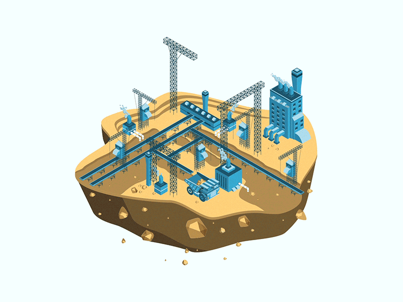

Hello!

Picture of an iridescent gemstone. source: https://www.heroscreen.cc/2025/02/abstract-iridescent-mineral-wallpaper.html

  

  

I'm a PhD candidate at the Geology & Sustainable Mining Institute (GSMI), UM6P, Morocco. My research focuses on the integration of stochastic simulation and machine learning for mineral resource estimation.

🔭 Kriging, SGS, SIS, Monte Carlo, Markov chains, ML
🇧🇫 From Burkina Faso, based in Morocco 🇲🇦
Reach me at: Fadel.SEBGO@um6p.ma

  

Languages and Tools:

  
   
  
  

